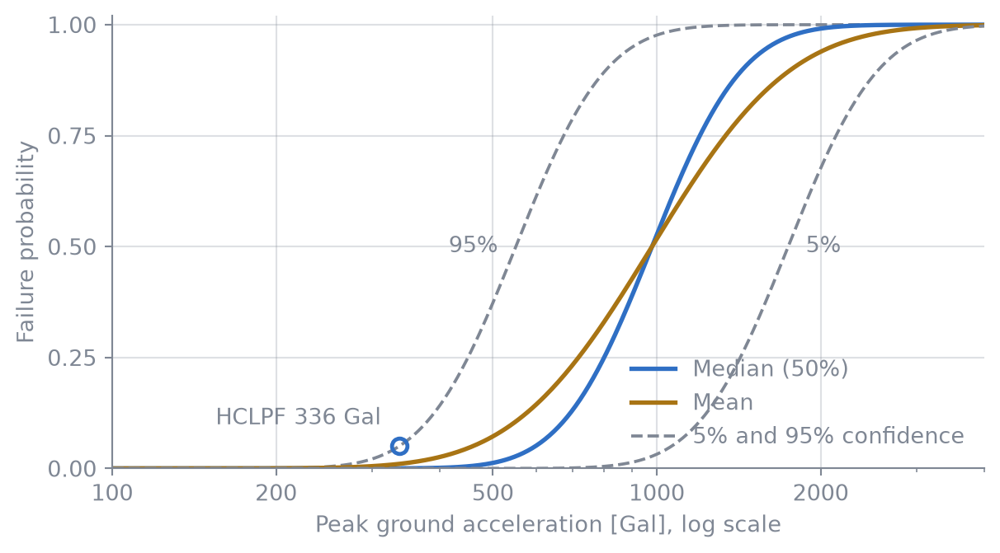

# Aleatory and Epistemic Uncertainty

Seismic PRA

Basics

Splitting fragility uncertainty into two kinds lets us state a failure probability and how far that probability can be trusted.

Keywords

Aleatory uncertainty, epistemic uncertainty, confidence, mean fragility

## Two kinds of uncertainty

Seismic PRA separates the spread in component capacity into two kinds.

- **Aleatory uncertainty** $\beta_R$ is inherent randomness. Even for the same level of shaking, the outcome varies with the frequency content of the ground motion and the response of the structure. More data does not reduce it.
- **Epistemic uncertainty** $\beta_U$ is lack of knowledge about the median capacity $A_m$. Further testing and analysis can reduce it.

## A family of fragility curves

Treating $\beta_U$ as uncertainty in the estimated median turns the single fragility curve into a family of curves, one for each confidence level $Q$.

$$f_Q(a) = \Phi\!\left(\frac{\ln(a/A_m) + \beta_U\,\Phi^{-1}(Q)}{\beta_R}\right)$$

The 95% confidence curve is the upper curve: with 95% confidence, the failure probability is no higher than this. The circle in [Figure 1](#fig-family) marks the HCLPF point from the previous article.

Figure 1: Family of fragility curves ($A_m$ = 980 Gal, $\beta_R$ = 0.30, $\beta_U$ = 0.35). The dashed lines are the 5% and 95% confidence curves. The circle is the point on the 95% curve where the failure probability is 5% (HCLPF ≈ 336 Gal).

## Mean fragility

Averaging the family over $Q$ gives a single mean fragility curve.

$$\bar f(a) = \Phi\!\left(\frac{\ln(a/A_m)}{\beta_C}\right),\qquad \beta_C = \sqrt{\beta_R^2 + \beta_U^2}$$

The mean curve is flatter than the median curve, so it gives higher failure probabilities at low accelerations. At $a = 500$ Gal, for example, the median curve gives 1.2% and the mean curve gives 7.2%.

> **TIP:**
>
> Whether a given uncertainty counts as aleatory or epistemic is partly a modelling choice. If $\beta_C$ stays the same, the mean fragility does not change, but the spread between the confidence curves does.
